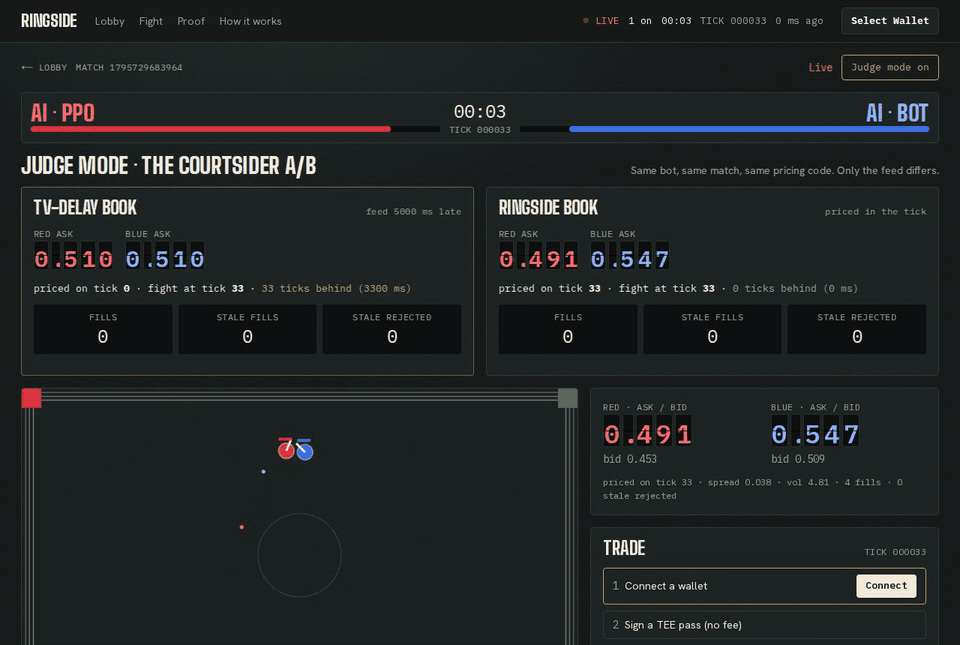
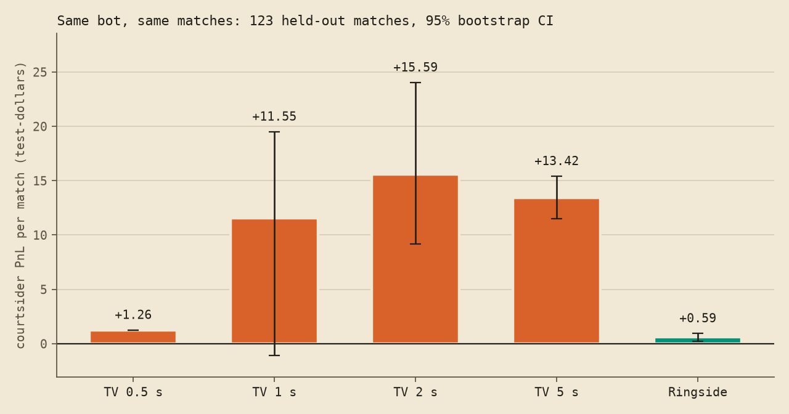
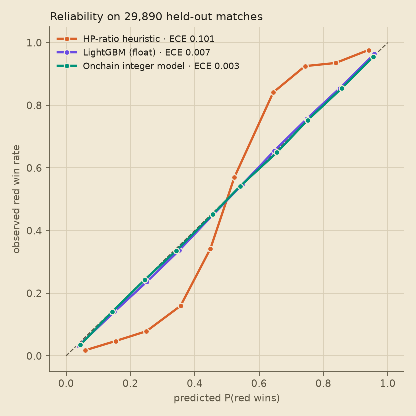

# Ringside

Ringside is an in-play betting exchange that can't be courtsided: the fight and the order book live in the same MagicBlock rollup, so every price is as fresh as the last punch.

Same bot, same 11 held-out matches, 5 s TV delay: the courtsider made **+4.38** per match on the delayed book and **+0.00** on Ringside, where 1283 of its stale orders were rejected onchain and 0 filled. Measured on Solana devnet + MagicBlock devnet-tee.



## Try it

| | |
|---|---|
| Live app | https://ringside.prashant101007.workers.dev |
| Video | PENDING |
| Program (devnet) | [`4efktEjqvfqi5UpmStUmvHmhJ9yFcKNvpZRJw56t5Kej`](https://explorer.solana.com/address/4efktEjqvfqi5UpmStUmvHmhJ9yFcKNvpZRJw56t5Kej?cluster=devnet) |
| Fee vault (house eATA owner: Config PDA) | [`Gn2PTrRkfkFpvy3oU7FNMwSsPvaQ9fg61SoKeKMR4UqK`](https://explorer.solana.com/address/Gn2PTrRkfkFpvy3oU7FNMwSsPvaQ9fg61SoKeKMR4UqK?cluster=devnet) |
| Model params, v1 | [account](https://explorer.solana.com/address/ATTNMp41xs7zeUxSdFMD3iBBhMp2QM8KMWxhoebZuEaF?cluster=devnet) |

Onchain proof from one live match on devnet-tee:

| Event | Transaction |
|---|---|
| VRF power-up wave (callback) | https://explorer.solana.com/tx/WEuv5cCWGbG5bgwQrFU8Yu8UjX77vXc3cS8NDmimyPn7j61J1W7ibNXuKxq5GZQLRTqDB5iTsKUfDoqvGqup9A5?cluster=custom&customUrl=https%3A%2F%2Fdevnet-tee.magicblock.app |
| Stale order rejected (`ErrStaleTick`) | https://explorer.solana.com/tx/591tfysPXLzBBhrxirr7dr19rJw4T6iNAmap7ig9tbbTCzhMSwvDNFxFqn3Hy3ezW4MMSsCR9i49jqZtVtR7QN2Y?cluster=custom&customUrl=https%3A%2F%2Fdevnet-tee.magicblock.app |
| Fighter trading their own match rejected (`ErrFighterBarred`) | https://explorer.solana.com/tx/2Bw1FoM5JZQAsaDYzqQGknUUSkx58BQRLkWJRUeify2D1F3DHZM78TXMckcwKyrYB91ZYSQt3YqHrDBoiJGZjvNT?cluster=custom&customUrl=https%3A%2F%2Fdevnet-tee.magicblock.app |
| Settlement (inside the crank) and reveal of positions | https://explorer.solana.com/tx/2tLKFwJ1tLYGxAYFioZsZ9kDJok5QDDvVJsfqnkqsfmXcWra8MkWq9KM1ds9rKY5ELYrcJrkR2WuXtGjN7cehMft?cluster=custom&customUrl=https%3A%2F%2Fdevnet-tee.magicblock.app |
| Commit to Solana | https://explorer.solana.com/tx/3Uk5DY4rXV9fWrqgmnc9QyyiMFGK5BarrkGUCrzxvxFQSsBa5cba54HHb8msKnb2WSozXdapf9CeY9FhDd7UhdKx?cluster=devnet |
| MatchRecord written by the Magic Action | https://explorer.solana.com/address/A7x8dRinneeA9CCn41KvAFdPb5D5jub5dwiKtyWFEmrW?cluster=devnet |

Spectators use devnet test-dollars, a 6-decimal mint we created because the Circle devnet USDC faucet can't fund a house vault. The program takes any mint at setup; real devnet USDC works the same way.

## The problem

Sportsbooks stream 5–8 seconds behind the action and freeze markets because faster watchers pick off stale prices. That is courtsiding: someone at the venue, or on a faster feed, trades against odds that haven't seen the point yet. Operators answer with suspensions and in-play delays on bets ([UK Gambling Commission on in-play betting](https://www.gamblingcommission.gov.uk/), [stream delay coverage on SBC News](https://www.sbcnews.co.uk/), [Courtsiding on Wikipedia](https://en.wikipedia.org/wiki/Courtsiding)).

Ringside removes the gap instead of policing it. The instruction that advances the duel also re-prices the book, and every order carries the tick it was priced on. An order more than 2 ticks behind the book is rejected by the program.

## How it works

Two staked fighters play a 90-second top-down duel that runs fully onchain: a deterministic integer simulation in Q16.16, stepped by a crank every 100 ms. Power-up waves come from VRF every 15 seconds. After each step the same instruction hashes the state into a chain, computes 16 features, runs a calibrated logistic model in integer math (1024-entry sigmoid table plus a 64-knot isotonic table) and writes new quotes. Spectators buy and sell "red wins" or "blue wins" shares against a house that skews its quotes by inventory and caps its worst-case loss.

```
Solana devnet          Config · ModelParams · Profile · MatchRecord · mint · eSPL vault
   │ delegate (validator = TEE)                         ▲ commit + Magic Action (MatchRecord)
   ▼                                                    │
MagicBlock Private ER (devnet-tee)
   Match (public) · Market ×2 (public) · Position ×N (private until settle) · eATAs
   crank: tick + settle every 100 ms · VRF ephemeral queue: one seed per wave
   ▲ token-auth websocket          ▲ session-key transactions
Indexer (Rust, Postgres)     Web (Next.js, Pixi, WASM sim)     Bots (TS + ONNX PPO)
```

Why every account sits on the TEE validator: a trade must write the Market and the spectator's Position in one transaction, and the tick must read the Match and write the Market. Only accounts delegated to the same validator can change together, and private positions need the TEE, so the match, both books, the positions and the token custody are all delegated to devnet-tee. The Match and Markets have no permission and stay public there. Positions are private until `settle` flips them public.

Each match has two books on the same fight. The Ringside book is priced inside `tick`. The TV-delay book runs the same pricing code on features a relay posts after a configurable delay (0.5–8 s): the world a sportsbook with a broadcast delay lives in. That is the A/B.

## MagicBlock, load-bearing

| Primitive | What Ringside uses it for | What breaks without it |
|---|---|---|
| Ephemeral Rollup | The fight, both books and every fill in one delegated account set | Ticks and fills at L1 speed; prices lag the fight |
| Private ER (TEE) | Positions sealed by per-account permissions, revealed at settle | Open positions readable mid-fight |
| VRF | Power-up waves from the ephemeral queue, one request per wave | Predictable or operator-chosen waves |
| Crank (ScheduleTask) | `tick` + `settle` every 100 ms, task id = hash(program ‖ match) | Nobody advances the fight unless they pay to push it |
| Session keys | One wallet prompt, then 2 hours of gasless trades and inputs | A wallet popup per input and per trade |
| Ephemeral SPL | Stakes, house vault and payouts as eATA balances in the rollup | Every payout waits for an L1 transfer |
| Magic Router / TEE RPC | Clients find the delegated accounts; token-auth reads | Hard-coded endpoints, no private reads |
| Magic Actions | `finalize` commits the book and writes the MatchRecord on L1 | No checkable receipt of result and final hash on Solana |

## Results

All numbers below come from `eval/results/results.json`, written by `eval/make_report.py`. Evaluation is on held-out data: matches the courtsider was never tuned on, model metrics on a held-out 15% split by match, PPO win rates on match seeds never used in training.

### E1 · courtsiding A/B (23 matches)



| Book | Matches | Courtsider PnL / match | 95% CI | Stale fills accepted | House PnL / match |
|---|---|---|---|---|---|
| TV delay 0.5 s | 3 | +2.25 | -2.41 to +8.57 | 34 | -6.10 |
| TV delay 1 s | 4 | +1.89 | -1.58 to +5.78 | 46 | -0.68 |
| TV delay 2 s | 3 | +7.00 | +4.86 to +10.53 | 38 | -9.65 |
| TV delay 5 s | 11 | +4.38 | -1.76 to +9.73 | 176 | -4.87 |
| TV delay 8 s | 2 | +2.73 | +0.00 to +5.45 | 25 | -13.20 |
| Ringside | 23 | +0.00 | +0.00 to +0.00 | 0 | -0.87 |

On Ringside the courtsider sent 1302 orders stamped with the tick it saw on the delayed feed; 1283 were rejected with `ErrStaleTick`. It also traded at the live tick 0 times, where it pays the spread like everyone else.

### E2 · is the price right? (29890 held-out matches, 2859074 rows)



| Model | Brier | Log-loss | ECE |
|---|---|---|---|
| Coin flip | 0.2500 | 0.6931 | 0.0003 |
| HP-ratio heuristic | 0.1925 | 0.5653 | 0.1007 |
| LightGBM teacher (float) | 0.1639 | 0.4876 | 0.0073 |
| Logistic student (float) | 0.1735 | 0.5127 | 0.0038 |
| Logistic, onchain integer | 0.1736 | 0.5127 | 0.0034 |

The onchain integer model differs from the float student by 0.0031 in probability on average (0.0135 at p99). Training data: 200000 simulated matches with mixed bot pairings, every 5th tick, split by match.

### E3 · latency, measured

Tick cadence p50 100 ms, p95 111 ms, p99 137 ms over 14781 ticks. Quote age at fill is not observable from outside on the private rollup: a trader's transaction is visible only to its signer, so fills are indexed from the public market account without the tick the order saw (the program still enforces the 2-tick window on every fill). Trade submit to confirm p50 503 ms (p95 974 ms). Host: Asia (India), residential connection; rollup: https://devnet-tee.magicblock.app. A broadcast stream runs 5–8 s behind.

### E4 · soak

8 bots × 40 trades: 91.6% succeeded, confirm p50 262 ms and p99 352 ms. Peak house exposure 5.17 against a cap of 60. Compute: 38619 CU per tick at p50 (sim step, hash, features, model, quotes), 24677 CU per trade.

### E5 · sealed until the bell

Reads of a private Position during a live match: non-member with a valid TEE token 20/20 denied, unauthenticated 20/20 denied, the opposing fighter 20/20 denied. After the reveal the same non-member reads it 20/20 times. For comparison, a Position without a permission (a plain ER account) is readable by the same non-member in one call.

### E6 · replay determinism

19/19 matches re-simulated in WASM and 19/19 in Python reproduce the onchain hash chain exactly (10266 links). The same check runs in the browser on every `/replay` page. In CI, 10,000 random-input episodes give identical hash chains in native Rust, WASM and Python.

### E7 · AI fighters

The PPO fighter (141459456 steps of self-play against a league of past checkpoints and the scripted bots, 60 minutes on CPU) wins 100.0% against the aggressive bot, 100.0% against kiting, 99.7% against defensive and 100.0% against random, over 300 held-out episodes each.

### Where it falls short

- The distilled logistic that fits in a tick has held-out Brier 0.1736 against 0.1639 for the LightGBM teacher it was distilled from. We trade some accuracy for running inside the instruction.
- In the last 20 seconds of regulation the onchain model's ECE is 0.0249, against 0.0034 overall: a linear model underfits the swingy end of a fight.
- At a 0.5 s TV delay the courtsider's PnL per match is +2.25 (95% CI -2.41 to +8.57); the edge comes from the 2–8 s delays that real streams have.
- The courtsider's at-the-live-tick orders filled 0 of 1287 times: they are sent after two confirmed orders, so the quote is older than the 200 ms window when they land (trade round trip from this host p50 503 ms). A client far from the validator needs a wider window or a closer RPC.
- Measured tick cadence is p50 100 ms but p99 137 ms: the 100 ms crank is a target, not a guarantee.

Weakest case: Calibration is worst late in regulation. In the last 20 seconds of regulation the onchain model's ECE is 0.0249, against 0.0034 overall: a linear model underfits the swingy end of a fight.

## Reproduce

```bash
./tests/determinism/run.sh 10000                     # native = WASM = Python hash chains
cd tests/magicsvm && cargo +stable test --release    # program on MagicSVM (ER, VRF, crank, actions)
python ml/winprob/gen_data.py && python ml/winprob/train.py   # E2
python ml/ppo/train.py --minutes 60                  # E7
./scripts/deploy-devnet.sh                           # program + config + model + house + bots
cd bots && npx tsx lobby.ts --matches 50 --delays 500,2000,5000   # E1 (courtsider runs alongside)
python eval/e3_latency.py                            # E3 (indexer stats)
cd bots && npx tsx soak/setup.ts <match> 16 && ./soak/target/release/ringside-soak <match> 16 40   # E4
npx tsx scripts/e5-privacy.ts <match> live && npx tsx scripts/e5-privacy.ts <match> revealed           # E5
python eval/e6_replay.py 20                          # E6
python eval/make_report.py && python scripts/render_docs.py && python scripts/check_consistency.py
```

## Run locally

```bash
pnpm install && ./scripts/build-wasm.sh
anchor build --ignore-keys
./scripts/setup-local.sh            # local base validator + ER (Docker) + config, model, house, bots
docker run -d --name ringside-pg -e POSTGRES_USER=ringside -e POSTGRES_PASSWORD=ringside -e POSTGRES_DB=ringside -p 5434:5432 postgres:16
RINGSIDE_ENV=local cargo +stable run --release --manifest-path services/indexer/Cargo.toml
cd bots && RINGSIDE_ENV=local npx tsx lobby.ts
cd apps/web && pnpm dev             # http://localhost:3000
```

Layout: `programs/ringside` (Anchor 1.0 program), `crates/ringside-sim` (deterministic sim), `crates/ringside-fixed` (Q32.32 math, model, quotes, trade math), `crates/ringside-wasm` and `crates/ringside-py` (bindings), `crates/ringside-agent` (policy I/O), `apps/web`, `services/indexer`, `bots`, `ml`, `eval`, `tests`, `scripts`.

MIT licensed.
